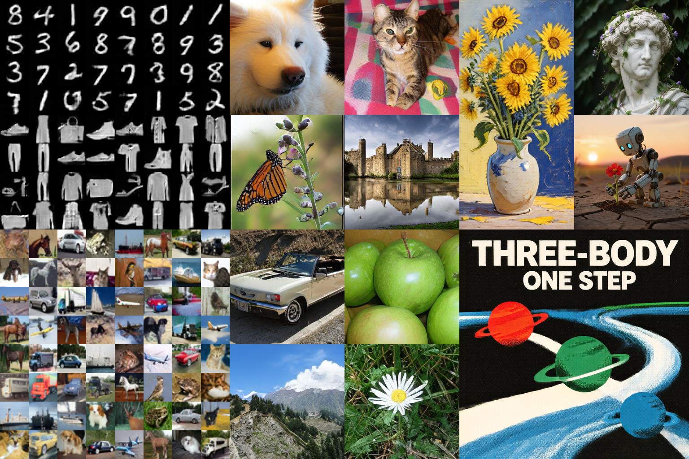
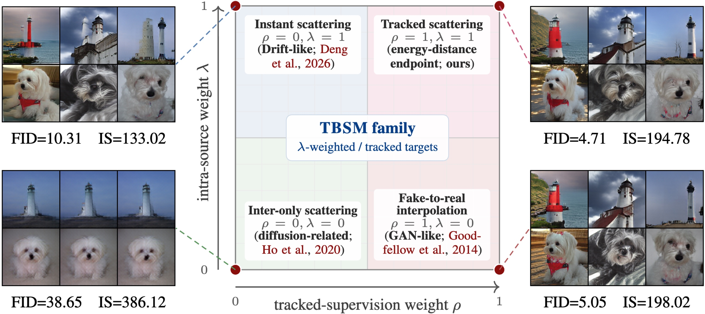
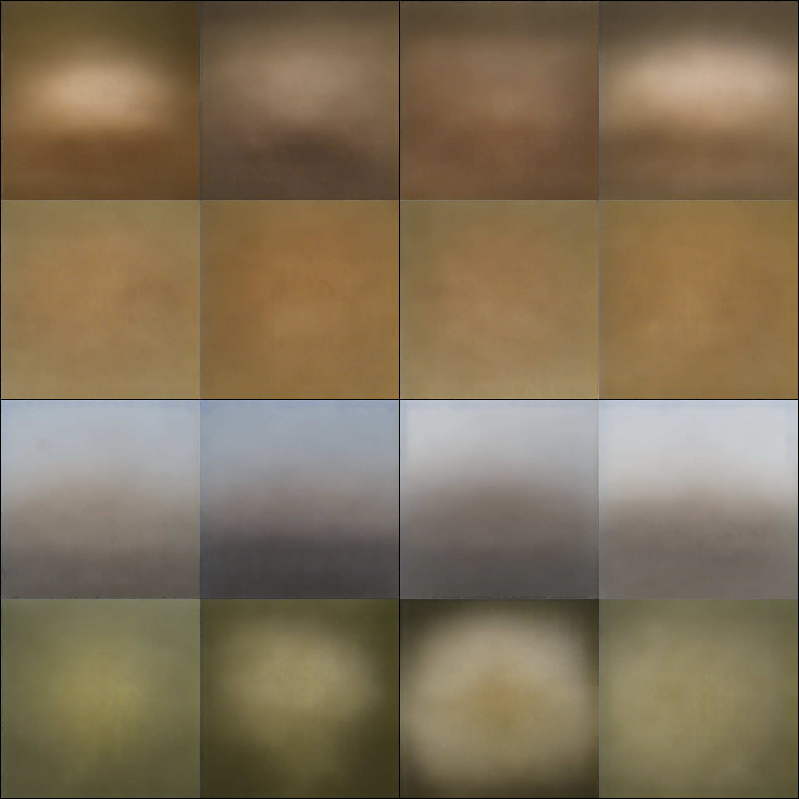
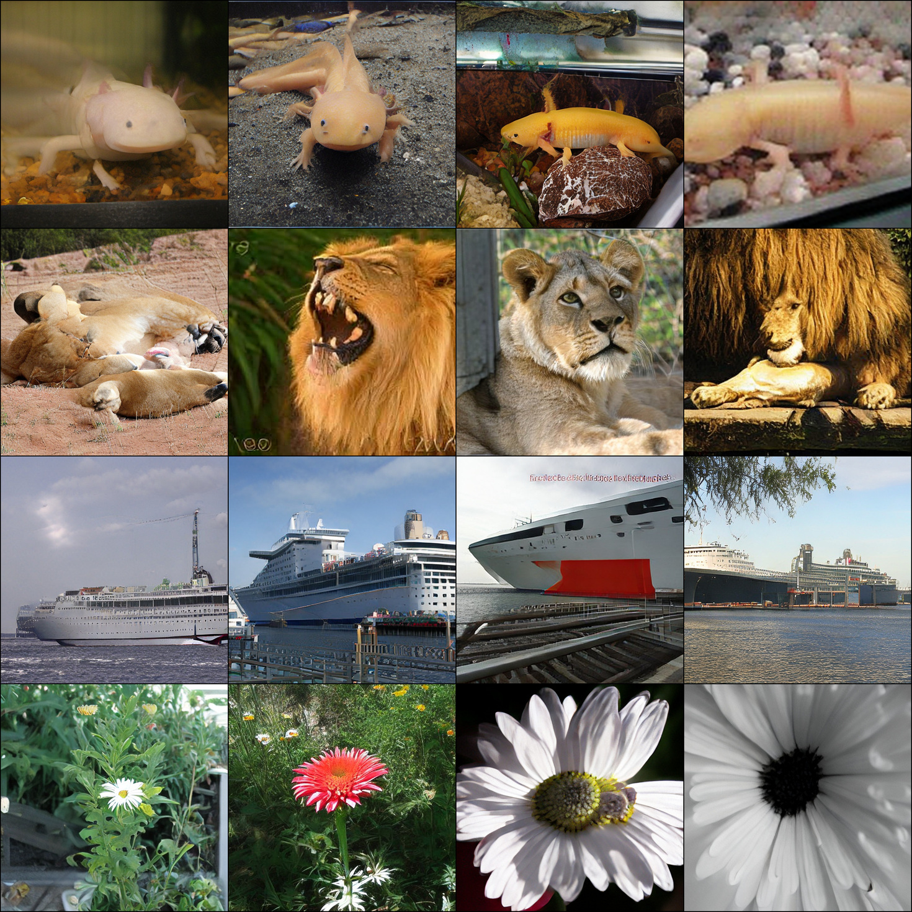

<h1 align="center">
  TBSM: Three-Body Scattering for Generative Modeling 
  Three-Body Interaction. One-Step Generation!
</h1>

  Peng Sun1,2 ·
  Zhenglin Cheng1,2 ·
  Deyuan Liu1 ·
  Jun Xie1,2 ·
  Xinyi Shang3 ·
  Tao Lin1

  1Westlake University &nbsp;&nbsp;
  2Zhejiang University &nbsp;&nbsp;
  3University College London

  <a href="https://arxiv.org/abs/2607.18198">Paper</a> ·
  <a href="#why-tbsm">Why TBSM?</a> ·
  <a href="#quick-start">Quick start</a> ·
  <a href="#todo">TODO</a> ·
  <a href="#citation">Citation</a>

https://github.com/user-attachments/assets/6edc364e-b7e4-4bc6-9806-e255939b41c1

TBSM in two acts: from three-body scattering to one-step generation.

One-step generation across datasets, resolutions, and output spaces.

One-step text-to-image generation at 1024 × 1024 resolution.

## Why TBSM?

<table align="center" width="100%">
  <tr>
    <th>Structural bottleneck</th>
    <th>Practical limitation</th>
  </tr>
  <tr><td><strong>GANs</strong> learned adversarial critic</td><td>training is sensitive to the adversarial min–max objective</td></tr>
  <tr><td><strong>AR / Diffusion</strong> ordered factorization or path-indexed objective</td><td>sequential decoding or iterative sampling slows inference</td></tr>
  <tr><td><strong>Drifting Models</strong> minibatch-wide pairwise field</td><td>all-pairs cost grows with batch size same-condition batches poorly fit one-image-per-caption T2I data</td></tr>
  <tr><td><strong>Diffusion distillation</strong> often requires extra distillation losses, auxiliary training models, schedules, or stabilization tricks</td><td>some pipelines require additional teacher or online score networks during training, increasing systems complexity and potentially peak GPU memory</td></tr>
</table>

<strong>At its energy-distance endpoint, TBSM turns a proper distributional energy into direct, sample-level supervision for one-step generation—without an adversarial critic, teacher queries, or a batch-wide all-pairs field.</strong>

<strong>Two parameters, one design space.</strong> 
The (ρ, λ) map links four TBSM configurations to Drift-like dynamics, diffusion-related supervision, and GAN-like objectives.

## Quick start

### Performance

<table align="center">
  <tr>
    <th align="center">Resolution</th>
    <th align="center">Space</th>
    <th>Backbone</th>
    <th align="center">NFE</th>
    <th align="center">FID ↓</th>
    <th align="center">IS ↑</th>
  </tr>
  <tr><td align="center">256²</td><td align="center">latent</td><td>DiT-XL/2</td><td align="center"><strong>1</strong></td><td align="center"><strong>1.63</strong></td><td align="center">243.0</td></tr>
  <tr><td align="center">256²</td><td align="center">pixel</td><td>PixelDiT-XL/16</td><td align="center"><strong>1</strong></td><td align="center"><strong>2.23</strong></td><td align="center">230.9</td></tr>
  <tr><td align="center">256²</td><td align="center">pixel</td><td>JiT-B/16</td><td align="center"><strong>1</strong></td><td align="center"><strong>2.69</strong></td><td align="center">247.4</td></tr>
  <tr><td align="center">512²</td><td align="center">latent</td><td>DiT-XL/4</td><td align="center"><strong>1</strong></td><td align="center"><strong>1.92</strong></td><td align="center">252.1</td></tr>
</table>

### Before and after · ImageNet-512

<table align="center" width="100%">
  <tr>
    <th align="center" width="50%">Before TBSM · NFE 1 · FID 398.20</th>
    <th align="center" width="50%">After TBSM · NFE 1 · FID 1.92</th>
  </tr>
  <tr>
    <td></td>
    <td></td>
  </tr>
</table>

### Run

The [minimal MNIST implementation](./minimal) provides a lightweight, low-cost path to understanding the core TBSM training algorithm through a compact, runnable example.

For full ImageNet-1K experiments, see the [ImageNet training and evaluation code](./imgnet), including configurations for pixel- and latent-space generators.

## TODO

- [x] Release a minimal TBSM implementation for quick experimentation
- [x] Release the ImageNet-1K training codebase
- [x] Release ImageNet-1K training assets used by the provided configurations ([Hugging Face](https://huggingface.co/sp12138sp/TBSM))
- [ ] Release the Qwen-Image-20B checkpoint
- [ ] Release the Qwen-Image-20B training code
- [ ] Update the paper

## Citation

    @article{sun2026three,
      title   = {Three-Body Scattering for Generative Modeling},
      author  = {Sun, Peng and Cheng, Zhenglin and Liu, Deyuan and Xie, Jun and Shang, Xinyi and Lin, Tao},
      journal = {arXiv preprint arXiv:2607.18198},
      year    = {2026}
    }

## License

This is a mixed-license repository. Unless otherwise noted, original TBSM code is licensed under the [Apache License 2.0](./LICENSE). Vendored or adapted third-party files remain subject to their upstream licenses. In particular, `imgnet/networks/backbones/pixeldit/` is governed by the [NVIDIA License (NSCLv1)](./LICENSES/PixelDiT-NSCLv1.txt), which permits use only for non-commercial research or evaluation. See [Third-Party Notices](./THIRD_PARTY_NOTICES.md) for file-level scope, attribution, and applicable license texts. External model weights and datasets remain subject to their upstream terms.
